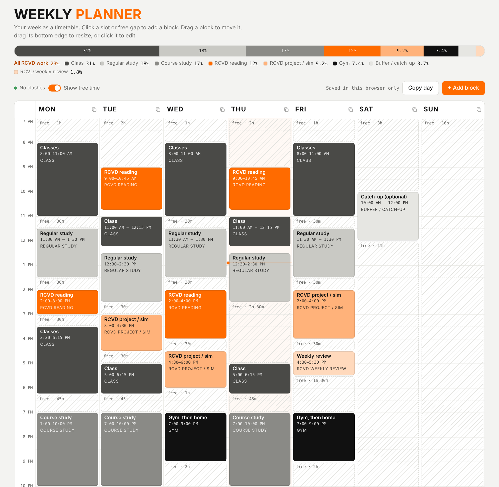

# Weekly Planner

A weekly timetable for planning study time around a fixed class schedule. Each block takes up space in proportion to the time it reserves, so you can see at a glance where the week goes.

The app is a single HTML file with no build step and no dependencies apart from Google Fonts.
A small shell sits beside it — a manifest, a service worker and generated icons — so it can
be installed as a desktop app.



## Features

- **Week grid over your waking hours**, Monday to Sunday, in 12-hour (AM/PM) time. Set *Awake ... to ...* above the grid and everything follows it: the spine, the free-time gaps and both share bars. Defaults to 7 AM–11 PM; bedtime can be midnight, and the shortest day you can set is four hours. Today's name is in the accent colour and its column is tinted; a white line marks the current time.
- **Add, edit and delete blocks.** Click any empty slot or free gap to add a block there; click a block to edit it. Each block has a title, label, day(s), start and end time (15-minute steps) and notes. On the grid a card is headed by its **label**, with the time under it and the first twelve words of its note below that; the block's own title is in the hover tooltip.
- **Drag to move and resize.** Drag a block up/down to change its time or sideways to change its day; drag its bottom edge to change its length. Snaps to 15 minutes. On touch screens, press and hold a block briefly before dragging, so normal swipes still scroll.
- **Repeating blocks.** Pick several days in the form to create a repeating block (shown with a ↻ icon). When editing one, choose *All repeats* or *Only this day*. Adding or removing days under *All repeats* adds or removes the copies.
- **Duplicate.** Duplicate a single block to other days, or copy a whole day (click the day name or *Copy day*) to other days, either alongside their existing blocks or replacing them.
- **Clash warnings.** Overlapping blocks get a red outline and a "!" badge. A pill above the grid counts clashes and expands into a clickable list. The edit form also warns if the time you are setting overlaps something (it still lets you save).
- **Free time.** Gaps of 15 minutes or more show as hatched "free · 1h 30m" areas; click one to fill it. A switch turns this off.
- **A "NOW:" bar.** Whatever is running right now appears as a thick bar above the grid, in its label's colour, with its name, label, note and time. It refreshes every 30 seconds, clicking it opens that block, and it disappears when nothing is scheduled.
- **Labels.** Colour-coded categories (class, study, gym…) that you can add, rename, recolour and delete.
- **Share bars, one per half of the week.** **Mon–Fri** and **Sat–Sun** get a pill-shaped bar each, because a weekday and a weekend are different kinds of day and a single average hides both. Each splits its own span — 80 h and 32 h on the default 7 AM–11 PM day, and more or less as you change your awake hours — by label and ends with everything still unscheduled as a hatched **Free** segment, so each bar adds up to 100%. Segments are labelled with percentages — dropped automatically when a segment is too narrow to show one — and the legend below gives each label's **total hours**, listing only the labels used in that half. Hovering either shows both figures. Overlapping blocks are counted once when working out free time, so a clash never pushes it negative.
- **Backup, export and import.** *Backup* downloads your whole week as a `.json` file or copies it to the clipboard, and takes it back in by file or paste — either added alongside what's already there or replacing it, behind a two-step confirm. This is how you move a week between browsers, devices and addresses.
- **Light and dark themes**, following the system setting.

## Running it

Open `index.html` in any modern browser. That's it.

It is also live on **GitHub Pages** at <https://alex-obeid.github.io/weekly-planner/>, deployed from
`main` / root — pushing to `main` redeploys it.

## Installing it as an app

Served over http(s), the planner is a PWA. Open <https://alex-obeid.github.io/weekly-planner/> in
Chrome or Edge and choose
**Install this site as an app** (the install icon at the right of the address bar, or
⋯ → Apps → Install). You get a Start-menu and taskbar entry that opens in its own window
with no browser chrome.

Three pieces make that work, and none of them matter when the page is opened as a file:

| File | Does what |
|---|---|
| `manifest.webmanifest` | Name, icons and `display: standalone`. Paths are relative, so it works both at a domain root and under `/weekly-planner/`. |
| `sw.js` | Caches the app shell so it opens with no internet. Navigations are network-first, so an online launch still picks up a new build. |
| `icons/` | Generated — **edit `tools/build-icons.py`, never the PNGs** (`python tools/build-icons.py`). |

The page also calls `navigator.storage.persist()`, which asks the browser not to evict your
week when disk runs low. Chrome grants this to installed apps; elsewhere it may decline,
which changes nothing else.

**When you change `index.html`, bump `VERSION` in `sw.js`.** An installed copy that is
offline will otherwise keep serving the build it cached.

Installing needs a served origin — `file://` cannot be installed. Opened as a file the page
behaves exactly as before: no service worker, no manifest, everything else unchanged.

## Where data is saved

The page picks its storage when it loads:

| Where it runs | Storage | Notes |
|---|---|---|
| Opened as a file or hosted anywhere (GitHub Pages, etc.) | Browser `localStorage`, key `rcvd-planner-v1` | Private to that browser on that device. Clearing site data erases it. A new browser starts with an empty week. |
| Published as a claude.ai artifact with the `db` capability | The artifact's database (`blocks` collection, `settings/labels` document) | Synced across devices; the status pill shows "Synced". |

The status text next to the buttons tells you which one is active ("Saved in this browser only" or "Synced").

### Backing up and moving your week

`localStorage` is scoped to one browser **and one address**. `file:///…/index.html`,
<https://alex-obeid.github.io/weekly-planner/> and `http://localhost:8000` are three separate
origins holding three separate, unrelated weeks — entering your timetable at one does not
make it appear at the others, and clearing site data erases it with no copy anywhere.

The **Backup** button is the way across. Export writes a `weekly-planner-<date>.json`
holding every block and label (internal ids are left out — they are regenerated on the way
in, so an import can never collide with what is already there). Import takes that file back,
or anything pasted into the box, and either adds it to the current week or replaces it.

Adding matches incoming labels to local ones **by name**, creating only what is missing, so
importing twice does not leave you with two "Class" labels. Repeating blocks keep their
grouping but are re-keyed, so an added copy forms its own series rather than joining an
existing one. Malformed blocks — a day outside 0–6, a time that isn't `HH:MM`, an end at or
before its start — are dropped rather than imported, and a file with nothing usable in it is
refused with the week untouched.

### Data model

```js
// a block
{ id, day, start, end, title, label, note, series? }
// day: 0 = Monday … 6 = Sunday
// start/end: "HH:MM" 24-hour strings (display is AM/PM)
// label: id of a label, or "" for none
// series: shared id for blocks created together as repeats

// a label
{ id, name, color }   // color: "#RRGGBB"
```

In local mode everything is stored as `{ blocks: [...], labels: [...] }` under the `rcvd-planner-v1` key. Two settings sit beside it rather than inside it: the free-time switch under `rcvd-planner-v1-free`, and your awake hours as `{ start, end }` (minutes from midnight) under `rcvd-planner-v1-day`. Neither travels with an export.

## Project structure

```
index.html              the whole app: markup, styles and script
manifest.webmanifest    name, icons and standalone display for the installed app
sw.js                   offline shell - bump VERSION whenever index.html changes
icons/                  generated app icons
tools/build-icons.py    generates icons/ - edit this, never the PNGs
docs/screenshot.png
README.md
CLAUDE.md               notes for working on this repo with Claude Code
```

Inside `index.html` the script is organised into sections marked with `// ---` comments: state, persistence, analysis (clashes and free gaps), week grid, drag to move/resize, labels panel, block form, copy-day form, backup (export and import), the installable-app hooks, and boot.

## Customising

- **Visible hours:** set in the app (*Awake ... to ...*). `DAY_START` and `DAY_END` in the script are only the starting values for a browser that has never set them; `DAY_MIN_SPAN` is the four-hour floor.
- **Snap size:** `SNAP` (drag) and the `15` step in the time dropdowns.
- **Minimum free gap shown:** `MIN_GAP` (minutes).
- **Row height:** the `--ppm` CSS variable (pixels per minute).
- **Colours and fonts:** the tokens in the `:root` block at the top of the stylesheet, with dark-mode values in the two blocks below it.

## Ideas for later

Real dates and week-to-week navigation, exam/deadline markers, marking blocks done or skipped with planned-vs-done hours, a phone day view with swipe, a "now and next" card, a focus timer, weekly targets per label, .ics export, and links to a reading roadmap.
